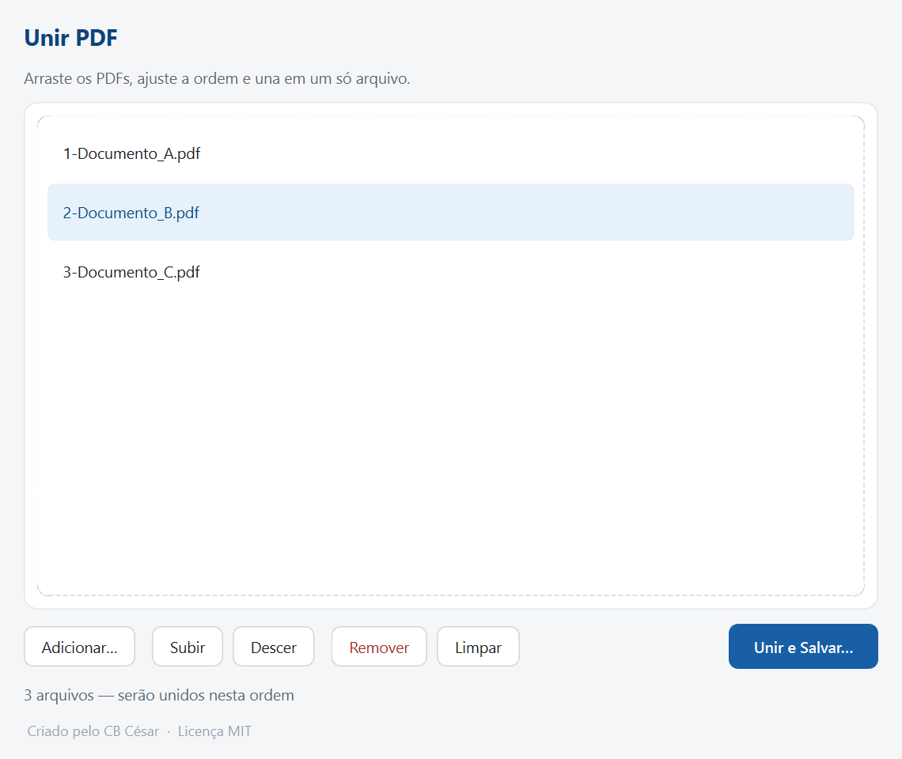

# Unir PDF

Aplicativo de desktop para **juntar vários arquivos PDF em um só**, na ordem que você quiser — arrastando e soltando na janela.




-41CD52?logo=qt&logoColor=white)


---

## Sobre

**Unir PDF** é um utilitário simples e direto para combinar PDFs sem depender de sites ou programas pesados. Você arrasta os arquivos, ajusta a ordem e gera o documento final — tudo local, sem enviar nada para a internet.

## Recursos

- **Arrastar e soltar** os PDFs direto na janela (ou pelo botão *Adicionar…*).
- Lista mostrando os arquivos **na ordem em que serão unidos**.
- **Reordenar** arrastando o item na lista ou com os botões *Subir* / *Descer*.
- **Remover** o arquivo selecionado ou **Limpar** toda a lista.
- **Unir e Salvar…** gera o PDF final na ordem exibida.
- Processamento **100% local** — nenhum arquivo sai do seu computador.

## Como usar (executável)

1. Baixe o **`UnirPDF.exe`** na aba [**Releases**](../../releases) deste repositório.
2. Dê duplo clique — não precisa ter o Python instalado.
3. Arraste seus PDFs para a janela, ajuste a ordem e clique em **Unir e Salvar…**.

> O Windows pode exibir um aviso do SmartScreen na primeira execução (é normal para executáveis sem assinatura digital). Basta clicar em *Mais informações* → *Executar assim mesmo*.

### Atalhos

| Tecla | Ação |
|---|---|
| `Ctrl + O` | Adicionar arquivos |
| `Delete` | Remover o selecionado |
| `Ctrl + ↑` | Subir na ordem |
| `Ctrl + ↓` | Descer na ordem |

## Rodar pelo código-fonte

Requer **Python 3.10+**.

```bash
# 1. Clone o repositório
git clone https://github.com/SEU-USUARIO/unir-pdf.git
cd unir-pdf

# 2. Crie e ative um ambiente virtual
python -m venv .venv
.venv\Scripts\activate        # Windows
# source .venv/bin/activate   # Linux/macOS

# 3. Instale as dependências
pip install -r requirements.txt

# 4. Execute
python unir_pdf.py
```

## Gerar o executável (.exe)

```bash
pyinstaller --noconfirm --onefile --windowed --name UnirPDF unir_pdf.py
```

O executável será criado em `dist/UnirPDF.exe`.

No Windows, também é possível simplesmente dar duplo clique em **`build.bat`**.

## Tecnologias

- [Python](https://www.python.org/)
- [PySide6](https://doc.qt.io/qtforpython/) (Qt for Python) — interface gráfica
- [pypdf](https://pypi.org/project/pypdf/) — leitura e junção dos PDFs
- [PyInstaller](https://pyinstaller.org/) — empacotamento em `.exe`

## Estrutura do projeto

```
unir-pdf/
├─ unir_pdf.py        # aplicação (interface + lógica de junção)
├─ test_app.py        # gera amostras, testa a junção e cria o preview
├─ preview_real.py    # gera a imagem de preview da janela
├─ build.bat          # atalho para compilar o .exe
├─ requirements.txt   # dependências
├─ LICENSE            # licença MIT
└─ preview.png        # captura de tela usada neste README
```

## Licença

Distribuído sob a licença **MIT**. Veja [LICENSE](LICENSE) para mais detalhes.

## Autor

**CB César**

---

Criado pelo **CB César** · Licença **MIT**
